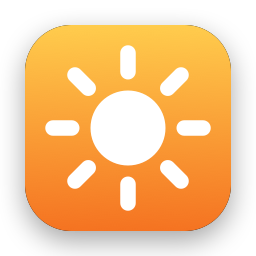
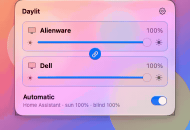
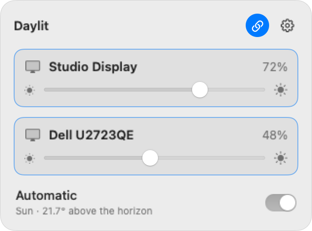
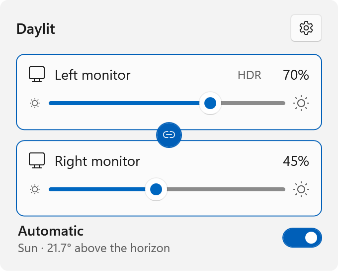
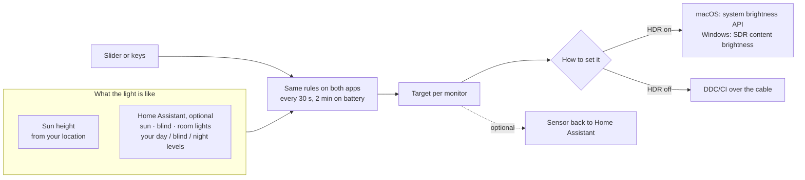

#  Daylit

**External monitor brightness that follows your day.**

[](https://github.com/Nachox07/daylit/actions/workflows/build.yml)
&nbsp;macOS 14+ · Windows 10/11 · MIT

A menu-bar app on macOS (SwiftUI) and a tray app on Windows (WPF with the Windows 11 Fluent theme).
Sliders and keys work from the first start. Add your location and brightness follows the sun. Add
[Home Assistant](https://www.home-assistant.io/) and the window blind and room lights move it too:
bright when daylight floods in, dimmer with the blind down, low at night.

<p align="center">
  <picture>
    <source media="(prefers-color-scheme: dark)" srcset="docs/demo-dark.gif">
    
  </picture>
</p>

With HDR on, many monitors ignore the usual DDC brightness command. Daylit still dims them:
[how](docs/hdr.md).

## Three ways to use it

| | You set up | Brightness follows |
|---|---|---|
| **Manual** | nothing | you: a slider and keys per monitor |
| **Sun** | your latitude and longitude | the sun's height, computed on your computer |
| **Home Assistant** | a URL and a token | the sun, a blind and the room lights; levels tunable from your dashboards |

With Home Assistant and a location, Daylit uses the sun when Home Assistant is unreachable, keeping the last levels and blind position Home Assistant gave, so a network blip doesn't move the screens.

<p align="center">
  <picture>
    <source media="(prefers-color-scheme: dark)" srcset="mac/Tests/Snapshots/panel-two-linked-dark.png">
    
  </picture>
  &nbsp;
  <picture>
    <source media="(prefers-color-scheme: dark)" srcset="windows/tests/Snapshots/panel-two-linked-dark.png">
    
  </picture>
</p>

## Install

**With Homebrew** (macOS): `brew install --cask nachox07/tap/daylit` (also installs `m1ddc` on Apple
silicon). The first open still needs **Open Anyway** in System Settings → Privacy & Security.

**Or download** the latest build from [Releases](https://github.com/Nachox07/daylit/releases/latest).

- **macOS** (`Daylit-mac-<version>.zip`, Apple silicon and Intel): unzip and move `Daylit.app` to
  Applications. The app is not notarized by Apple, so the first open is blocked: open System
  Settings → Privacy & Security, scroll to the message about Daylit and click **Open Anyway**. For
  DDC monitors on Apple silicon also run `brew install m1ddc`; m1ddc does not support Intel Macs,
  where only monitors that accept macOS's own brightness control work. To update, quit Daylit (gear
  menu → Quit) before replacing the app: a copy left running loses its connection to Home Assistant.
- **Windows** (`Daylit-windows-<version>.zip`): unzip anywhere, for example
  `%LOCALAPPDATA%\Programs\Daylit`, and run `Daylit.exe`. SmartScreen may warn about an unknown
  publisher: **More info → Run anyway**. It needs the
  [.NET 10 Desktop Runtime](https://dotnet.microsoft.com/download/dotnet/10.0)
  (`winget install Microsoft.DotNet.DesktopRuntime.10`).

**Or build it yourself**, if you prefer not to run unsigned downloads:

```sh
mac/build.sh            # macOS 14+, Xcode command-line tools → ~/Applications/Daylit.app
```

```powershell
windows\build.ps1       # Windows 10/11, .NET 10 SDK → %LOCALAPPDATA%\Programs\Daylit\Daylit.exe
```

Then open the gear menu → **Settings…** for your location or Home Assistant ([details](docs/setup.md)). Using an AI coding
agent? Point it at [AGENTS.md](AGENTS.md); the same steps are an [Agent Skill](https://agentskills.io)
in [`.agents/skills/configure-daylit`](.agents/skills/configure-daylit/SKILL.md).

## How it works



Every 30 seconds, every 2 minutes on battery (and at once after wake, a display change or opening the panel) each app works out
a target per monitor from three levels you choose: *day*, *blind closed* and *night*, in this order:

1. **The blind** picks the daytime level, between *blind closed* and *day*.
2. **The sun** blends it with *night*: night below −3° elevation, full daytime from 12°.
3. **Clouds**, optional: a daylight sensor in Home Assistant (solar panel power, or an outdoor light
   sensor) holds the sun's share down on an overcast day ([details](docs/setup.md#clouds-a-daylight-sensor)).
4. **Room lights** on around dusk keep it a little above *night*, so a lit room is not too dark. A monitor
   can have its own level for that instead, *lights on* (optional): then *night* is the dark-room level
   that clouds blend toward, and the lights slide it to *lights on* as the sun goes down
   ([details](docs/setup.md#lights-on-level)).
5. **Your hand.** A level you set keeps its distance from the target, so Daylit does not fight you:
   turn the screen 20 points down on a grey morning and it stays 20 below while the blind opens and the
   sun climbs. The distance fades out at sunset, so the next day starts clean; *Manual ✕* on the
   monitor's row goes back to automatic at once. When you keep correcting a monitor the same way
   on several days, the panel offers to change its level, with *Apply* and *Not now*; nothing changes
   without the click ([details](docs/setup.md#suggested-levels)).

Settings → *Automatic* draws all of this for today, with handles to choose when full brightness starts
and when night starts, and shows each step with the numbers right now
([the chart](docs/setup.md#when-the-screens-brighten)). The sun's position is computed locally; the tests check it against NOAA reference values to within 0.05°.

- **Two computers, one set of monitors.** When a Mac and a PC share monitors through input
  switching, only the one in use changes brightness. The idle one catches up when you come back.
- **Battery.** A laptop on battery pauses all automatic work (gear menu → *Pause on battery*).
- **Sync monitors.** With two or more monitors, the link button at the top of the panel makes them all move together: each keeps
  how much brighter or darker it was when you switched it on ([details](docs/setup.md#sync-monitors)).
- **A short panel.** It holds what you touch every day: a slider per monitor and *Automatic*.
  Everything set once is in the gear menu: **Settings…** (source, location, levels per monitor, Home
  Assistant), light/dark from daylight, pause on battery, open at login and shortcuts (including one that switches light and dark mode). Levels you set by hand survive a restart.
- **The built-in screen is left to the system**, whose light sensor does a better job than any
  schedule. On a Mac with the lid open, the panel still shows its slider for quick manual changes
  (on Windows, the quick-settings slider covers it).
- **Light and dark mode** can follow the same daylight and lights ([details](docs/setup.md#light-and-dark-mode)).
- **Contrast**, optional: a fixed value per monitor (Settings → Displays, or `"contrast": 60` in the config), set over DDC/CI
  at start and after a display change, wake or config reload. It is never automated
  ([details](docs/setup.md#contrast)).

## Settings on more than one Mac

Settings → App → **Keep settings in iCloud Drive** moves `config.json` to iCloud Drive
(`~/Library/Mobile Documents/com~apple~CloudDocs/Daylit/config.json`), so every Mac signed in to
your iCloud uses the same file. A change saved on one Mac shows up on the others within seconds of
iCloud bringing it over. macOS only: Windows keeps its own file.

- **The first Mac** copies its settings there. **The next one** uses what is already there and keeps
  its own file as `~/.config/daylit/config.local-backup.json`, so nothing is lost.
- **Turning it off** copies the iCloud file back to `~/.config/daylit/config.json`. The iCloud copy
  stays for your other Macs.
- **What stays on each Mac:** the Home Assistant token (in that Mac's keychain), levels set by hand,
  *Automatic*, linked monitors, and the gear menu's switches (pause on battery, light/dark from
  daylight, open at login).
- **Monitors match by name** (`match` is part of the display name), not by an id, so the same
  model is found on every Mac. Everything else in the file is shared, `builtIn` and `ddcTool` too.
- If the file is broken or still downloading, Daylit keeps the last settings that loaded and shows
  the problem. `DAYLIT_CONFIG`, when set, wins and turns the switch off.

## Contributing

Build, test and screenshot steps for both apps are in [CONTRIBUTING.md](CONTRIBUTING.md). Both apps
share their rules and have unit tests that run in CI on every push.

## License

[MIT](LICENSE). Home Assistant is a trademark of the Open Home Foundation; Daylit is not affiliated
with it. The Home Assistant icon in the settings window comes from
[Material Design Icons](https://pictogrammers.com/library/mdi/) (Apache-2.0).
