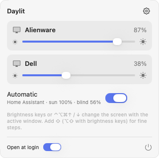
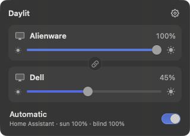
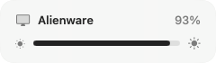
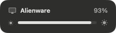
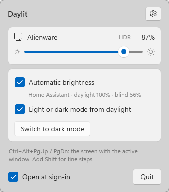
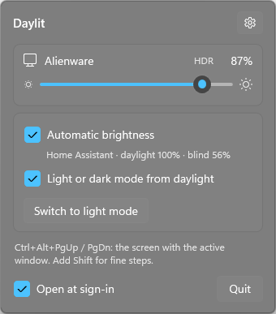
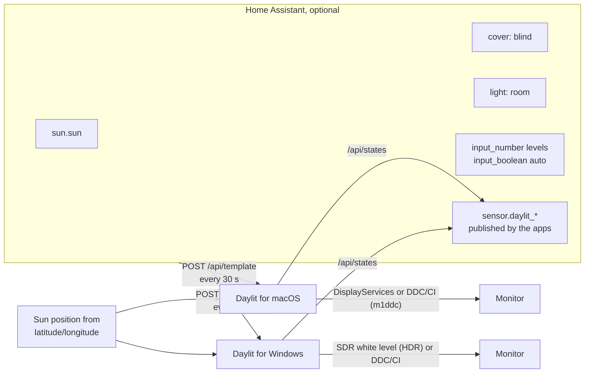

# Daylit

Daylit keeps your external monitors at the right brightness through the day. It works on its own as
a simple brightness control, follows the sun when you give it your location, and can read the sun,
a window blind and the room lights from [Home Assistant](https://www.home-assistant.io/): bright
when daylight floods in, dimmer with the blind down, low at night.

There are two small native apps with the same behaviour:

- **macOS**: a menu-bar app (Swift, SwiftUI). The keyboard's brightness keys control the monitor
  holding the focused window (the built-in screen keeps working as usual), and so do `⌃⌥⌘↑/↓`
  (add `⇧` for fine steps; change them in the gear menu → *Keyboard Shortcuts…*).
- **Windows**: a tray app (.NET 10, WPF with the Windows 11 Fluent theme). `Ctrl+Alt+PgUp/PgDn`
  (add `Shift` for fine steps; change them in the panel's gear menu → *Keyboard shortcuts…*), plus optional light/dark mode from the same signals.

Both find your external monitors by themselves and show a slider per monitor, a fading on-screen
indicator when you use the keys, and an "Automatic" switch.

<p>
  
  
</p>
<p>
  
  
</p>
<p>
  
  
</p>
<p>
  
  
</p>

## Three ways to run it

| Source | What you set up | What drives brightness |
|---|---|---|
| none (default) | nothing | you: sliders and keys |
| `sun` | your latitude and longitude | the sun's height, computed on your machine |
| `homeAssistant` | a Home Assistant URL and token | the sun, a blind and the room lights; levels tunable from HA dashboards |

With Home Assistant and a location, Daylit falls back to the sun when Home Assistant is unreachable.

## How it works



Every 30 seconds (2 minutes on battery, and at once after wake, a display change or opening the
panel) each app works out a target per monitor:

1. **Daytime level** slides between *blind closed* and *blind open* with the blind position
   (no blind: the *open* level).
2. **Sun** blends that with the *night* level: night below −3° elevation, full daytime from 12°.
3. **Lights on around dusk and at night** (sun below 1.5°) keep the level at least 5 points above
   the night value, so a lit room is not too dark.

A level you set by hand (slider or keys) is kept until the target moves by `manualHold` points
(default 5), so the app does not fight you.

The sun's elevation is computed locally with the standard low-precision solar formula; it matches
Home Assistant's `sun.sun` to about 0.01°.

**Two machines, one set of monitors.** When a Mac and a PC share monitors through input switching,
only the machine in use (input in the last 5 minutes) changes brightness or publishes to Home
Assistant. The idle one stays quiet, and catches up as soon as you use it again.

**On battery.** With *Pause on battery* on (the default, shown only on computers with a battery),
a laptop on battery does no automatic work at all: no updates, no Home Assistant traffic, no
light/dark changes. Sliders and keys still work, and plugging in resumes at once.

**No external monitor.** With nothing plugged in, the panel says so and Daylit polls nothing until
a monitor appears.

**The built-in screen is left to the system** on purpose: macOS and Windows already adjust it from
its own light sensor, which does a better job than any schedule.

With Home Assistant, what was applied is published back as a sensor (`target`, `manual`,
`daylight`, `blind`, `lights`, `source` attributes), so you can graph it.

## The HDR finding

With HDR on, many monitors ignore DDC/CI brightness: reading VCP 0x10 works, writing it does nothing.

- **macOS**: the system brightness API (`DisplayServices`, the same one the built-in screen uses)
  still works on those monitors. Daylit tries it first for each monitor and falls back to DDC/CI
  through `m1ddc`; `"control": "native"` or `"ddc"` forces one.
- **Windows**: the control that works is the **SDR content brightness** slider (Settings → Display →
  HDR). There is no public API for it. Daylit sets it with the undocumented
  `DisplayConfigSetDeviceInfo` request type `0xFFFFFFEE`, the one the Settings app uses, with a level
  of 1000–6000 (80–480 nits) mapped to 0–100. When HDR is off it uses DDC/CI (`dxva2`) instead.
  Detection is automatic per monitor.

## Install

macOS 14+ with the Xcode command-line tools, and [`m1ddc`](https://github.com/waydabber/m1ddc) for
DDC monitors (`brew install m1ddc`):

```sh
mac/build.sh            # → ~/Applications/Daylit.app
open ~/Applications/Daylit.app
```

The first start asks for Accessibility permission (needed for the brightness keys; the `⌃⌥⌘↑/↓`
shortcuts work without it) and, with Home Assistant on your network, for Local Network access.
Until you allow it, Daylit cannot reach Home Assistant and uses the sun and your local levels. The build is signed with your Apple Development identity when you have
one, so the permission survives rebuilds. Opening the app again shows its panel. Log:
`~/Library/Logs/Daylit/daylit.log`.

Windows 10/11 with the .NET 10 SDK (the app itself needs the .NET 10 Desktop Runtime):

```powershell
windows\build.ps1       # → %LOCALAPPDATA%\Programs\Daylit\Daylit.exe
```

CI builds both on every push ([`.github/workflows/build.yml`](.github/workflows/build.yml)); the
Windows build is attached to each run as an artifact.

## Configure (optional)

Without a config file Daylit manages every external monitor by hand. For automatic brightness,
use the panel's **Open config file** (it creates one) or write it yourself:

- macOS: `~/.config/daylit/config.json`
- Windows: `%APPDATA%\Daylit\config.json`

Every key is optional; [`config.example.json`](config.example.json) shows them all.

- `location`: `latitude` and `longitude` for the `sun` source (and as a fallback for Home Assistant).
- `monitors`: per-monitor overrides. `match` is any part of the monitor's name (case-insensitive)
  as the system shows it. `label`, the three levels `day`, `blindDown`, `night` (0–100), and on
  macOS `control`.
- `homeAssistant`: `url`, `tokenName`, and the entities `autoSwitch`, `sun`, `cover`, `lights`
  (each optional). A monitor's own `homeAssistant` block names its three `input_number` levels,
  the `sensor` to publish and, optionally, a `set` helper: changing it in Home Assistant sets that
  monitor right away, even when the computer is idle (dim it from your phone while away). It then
  counts as a hand-set level: automatic mode keeps it until the target moves `manualHold` points,
  or for good if you switch automatic off.
- `pauseOnBattery` (default `true`): the starting value of the panel's *Pause on battery* switch;
  once you change the switch, the app keeps your choice.
- `manualHold`, and on macOS `ddcTool` (path to `m1ddc` if it is not in Homebrew's usual place).

Use **Reload config** in the panel after editing.

`--list-monitors` prints the connected monitors with the `match` text to use, and `--check-config`
validates the file: `Daylit.exe --list-monitors | Out-String` on Windows,
`~/Applications/Daylit.app/Contents/MacOS/Daylit --list-monitors` on macOS. Setting it up with an AI agent: see [AGENTS.md](AGENTS.md); Claude Code also picks up the `configure-daylit` skill.

### Home Assistant

Create the helpers: one `input_boolean` for automatic mode and three `input_number`s per monitor
(day, blind closed, night). [`homeassistant/daylit_helpers.yaml`](homeassistant/daylit_helpers.yaml)
has a ready package. Then create a long-lived access token (your profile → Security). The blind and
the lights are optional.

The token never goes in the config file. With an `http://` URL it travels unencrypted on your
local network; use your `https://` address if you have one. On macOS, plain `http://` works for
local addresses only (an IP, `*.local` or a single-word host name).

- macOS, keychain: `security add-generic-password -s daylit-home-assistant -a homeassistant -w`
  (it prompts for the token).
- Windows: the app asks on first start and stores it in Credential Manager. Right-click the tray
  icon → *Home Assistant token…* to change it.

The name is `tokenName` (default `daylit-home-assistant`).

## Light and dark mode

Optional, switchable in the panel, with the sun or Home Assistant source: on by default on Windows,
off by default on macOS. Light mode when daylight
comes in (sun above 4°, and with Home Assistant the blind at least 55 % open) or when the room
lights are bright and white; dark otherwise, including night with dim or orange lights. Each
condition has a gap between its on and off thresholds so it does not flip back and forth, and a
manual switch stays until the automatic decision next changes. If the wallpaper is one of
Windows 11's stock light/dark pair, it is swapped too; a custom wallpaper is never touched.

On macOS it switches the system appearance through System Events, so the first switch asks for the
Automation permission (System Settings → Privacy & Security → Automation). The gear menu also has a
manual *Switch to Light/Dark Mode*. An idle computer, or one paused on battery, leaves the
appearance alone.

## License

MIT
