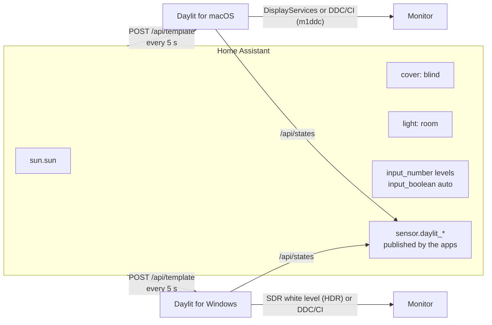

# Daylit

Daylit keeps your external monitors at the right brightness through the day. It reads the sun, a
window blind and the room lights from [Home Assistant](https://www.home-assistant.io/), and sets each
monitor from that: bright when daylight floods in, dimmer with the blind down, low at night.

There are two small native apps with the same behaviour:

- **macOS**: a menu-bar app (Swift, SwiftUI). The keyboard's brightness keys control the monitor
  holding the focused window; the built-in screen keeps working as usual.
- **Windows**: a tray app (.NET 8, WinForms). `Ctrl+Alt+PgUp/PgDn` (add `Shift` for fine steps), plus
  optional light/dark mode from the same signals.

Both show sliders, a fading on-screen indicator, and an "Automatic" switch that is a Home Assistant
helper, so a dashboard, an automation or the app can turn it on and off.

## How it works



Every 5 seconds each app sends one template to `POST /api/template` and gets back the sun elevation,
the blind position, the lights state, the automatic switch and the three levels of every monitor.
It then computes a target per monitor:

1. **Daytime level** slides between *blind closed* and *blind open* with the blind position.
2. **Sun** blends that with the *night* level: night below −3° elevation, full daytime from 12°.
3. **Lights on around dusk and at night** (sun below 1.5°) keep the level at least 5 points above
   the night value, so a lit room is not too dark.

A level you set by hand (slider or keys) is kept until the target moves by `manualHold` points
(default 5), so the app does not fight you. What was applied is published back to Home Assistant as a
sensor (`target`, `manual`, `daylight`, `blind`, `lights`, `source` attributes), so you can graph it.

When a Mac and a PC share the same monitors, each app only publishes while someone is using that
machine (no input for 5 minutes = idle), and publishes again when you come back to it. Both still
*apply* brightness while idle; the monitor just follows whichever machine it is showing.

## The HDR finding

With HDR on, many monitors ignore DDC/CI brightness: reading VCP 0x10 works, writing it does nothing.

- **macOS**: the system brightness API (`DisplayServices`, the same one the built-in screen uses)
  still works on those monitors. Set `"control": "native"` for them; use `"ddc"` for the rest.
- **Windows**: the control that works is the **SDR content brightness** slider (Settings → Display →
  HDR). There is no public API for it. Daylit sets it with the undocumented
  `DisplayConfigSetDeviceInfo` request type `0xFFFFFFEE`, the one the Settings app uses, with a level
  of 1000–6000 (80–480 nits) mapped to 0–100. When HDR is off it uses DDC/CI (`dxva2`) instead.
  Detection is automatic per monitor.

## Setup

### 1. Home Assistant

Create the helpers: one `input_boolean` for automatic mode and three `input_number`s per monitor
(day, blind closed, night). [`homeassistant/daylit_helpers.yaml`](homeassistant/daylit_helpers.yaml)
has a ready package. Then create a long-lived access token (your profile → Security).

The blind and the lights are optional: without a cover the daytime level is the "blind open" one,
without lights there is no night boost.

### 2. Config file

Copy [`config.example.json`](config.example.json) and edit it:

- macOS: `~/.config/daylit/config.json`
- Windows: `%APPDATA%\Daylit\config.json`

`match` is any part of the monitor's name (case-insensitive) as the system shows it (System Settings → Displays on the
Mac, Settings → Display → Advanced display on Windows). `control` is used on macOS only, and so is
`ddcTool`, the path to `m1ddc` if it is not in Homebrew's usual place.

### 3. Token

The token never goes in the config file. Note that with an `http://` URL it travels unencrypted on
your local network; use your `https://` Home Assistant address if you have one. On macOS, plain
`http://` works for local addresses only (an IP, `*.local` or a single-word host name).

- macOS, keychain: `security add-generic-password -s daylit-home-assistant -a homeassistant -w`
  (it prompts for the token).
- Windows: the app asks on first start and stores it in Credential Manager. Right-click the tray
  icon → *Home Assistant token…* to change it.

The name is `tokenName` in the config (default `daylit-home-assistant`).

### 4. Build and run

macOS 14+ with the Xcode command-line tools, and [`m1ddc`](https://github.com/waydabber/m1ddc) for
DDC monitors (`brew install m1ddc`):

```sh
mac/build.sh            # → ~/Applications/Daylit.app
open ~/Applications/Daylit.app
```

The first start asks for Accessibility permission (needed for the brightness keys). The build is
signed with your Apple Development identity when you have one, so the permission survives rebuilds.

Windows 10/11 with the .NET 8 SDK:

```powershell
windows\build.ps1       # → %LOCALAPPDATA%\Programs\Daylit\Daylit.exe
```

CI builds both on every push ([`.github/workflows/build.yml`](.github/workflows/build.yml)); the
Windows build is attached to each run as an artifact.

## Light and dark mode (Windows)

Optional, on by default, switchable in the panel. Light mode when daylight comes in (sun above 4°
and blind at least 55 % open) or when the room lights are bright and white; dark otherwise, including
night with dim or orange lights. Each condition has a gap between its on and off thresholds so it
does not flip back and forth, and a manual switch stays until the automatic decision next changes.
If the wallpaper is one of Windows 11's stock light/dark pair, it is swapped too; a custom wallpaper
is never touched.

## License

MIT
