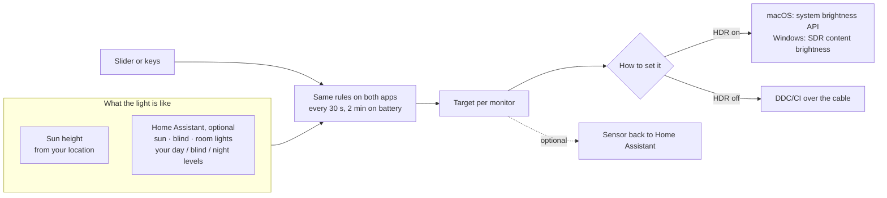

# Daylit

**External monitor brightness that follows your day.**

[](https://github.com/Nachox07/daylit/actions/workflows/build.yml)
&nbsp;macOS 14+ · Windows 10/11 · MIT

A menu-bar app on macOS (SwiftUI) and a tray app on Windows (WPF with the Windows 11 Fluent theme).
Sliders and keys work from the first start. Add your location and brightness follows the sun. Add
[Home Assistant](https://www.home-assistant.io/) and the window blind and room lights move it too:
bright when daylight floods in, dimmer with the blind down, low at night.

<p align="center">
  <picture>
    <source media="(prefers-color-scheme: dark)" srcset="docs/demo-dark.gif">
    
  </picture>
</p>

With HDR on, many monitors ignore the usual DDC brightness command. Daylit still dims them:
[how](docs/hdr.md).

## Three ways to use it

| | You set up | Brightness follows |
|---|---|---|
| **Manual** | nothing | you: a slider and keys per monitor |
| **Sun** | your latitude and longitude | the sun's height, computed on your computer |
| **Home Assistant** | a URL and a token | the sun, a blind and the room lights; levels tunable from your dashboards |

With Home Assistant and a location, Daylit uses the sun when Home Assistant is unreachable, keeping the last levels and blind position Home Assistant gave, so a network blip doesn't move the screens.

<p align="center">
  <picture>
    <source media="(prefers-color-scheme: dark)" srcset="mac/Tests/Snapshots/panel-two-linked-dark.png">
    
  </picture>
  &nbsp;
  <picture>
    <source media="(prefers-color-scheme: dark)" srcset="windows/tests/Snapshots/panel-two-linked-dark.png">
    
  </picture>
</p>

## Install

**Download** the latest build from [Releases](https://github.com/Nachox07/daylit/releases/latest).

- **macOS** (`Daylit-mac-<version>.zip`, Apple silicon and Intel): unzip and move `Daylit.app` to
  Applications. The app is not notarized by Apple, so the first open is blocked: open System
  Settings → Privacy & Security, scroll to the message about Daylit and click **Open Anyway**. For
  DDC monitors on Apple silicon also run `brew install m1ddc`; m1ddc does not support Intel Macs,
  where only monitors that accept macOS's own brightness control work. To update, quit Daylit (gear
  menu → Quit) before replacing the app: a copy left running loses its connection to Home Assistant.
- **Windows** (`Daylit-windows-<version>.zip`): unzip anywhere, for example
  `%LOCALAPPDATA%\Programs\Daylit`, and run `Daylit.exe`. SmartScreen may warn about an unknown
  publisher: **More info → Run anyway**. It needs the
  [.NET 10 Desktop Runtime](https://dotnet.microsoft.com/download/dotnet/10.0)
  (`winget install Microsoft.DotNet.DesktopRuntime.10`).

**Or build it yourself**, if you prefer not to run unsigned downloads:

```sh
mac/build.sh            # macOS 14+, Xcode command-line tools → ~/Applications/Daylit.app
```

```powershell
windows\build.ps1       # Windows 10/11, .NET 10 SDK → %LOCALAPPDATA%\Programs\Daylit\Daylit.exe
```

Then open the gear menu → **Settings…** for your location or Home Assistant ([details](docs/setup.md)). Using an AI coding
agent? Point it at [AGENTS.md](AGENTS.md); the same steps are an [Agent Skill](https://agentskills.io)
in [`.agents/skills/configure-daylit`](.agents/skills/configure-daylit/SKILL.md).

## How it works



Every 30 seconds, every 2 minutes on battery (and at once after wake, a display change or opening the panel) each app works out
a target per monitor from three levels you choose: *day*, *blind closed* and *night*.

1. The daytime level slides between *blind closed* and *day* with the blind position.
2. The sun blends it with *night*: night below −3° elevation, full daytime from 12°.
3. Room lights on around dusk keep it a little above *night*, so a lit room is not too dark.

A level you set by hand stays until the target moves 5 points, so Daylit does not fight you. The
sun's position is computed locally; the tests check it against NOAA reference values to within 0.05°.

- **Two computers, one set of monitors.** When a Mac and a PC share monitors through input
  switching, only the one in use changes brightness. The idle one catches up when you come back.
- **Battery.** A laptop on battery pauses all automatic work (gear menu → *Pause on battery*).
- **Sync monitors.** With two or more monitors, the link button at the top of the panel makes them all move together: each keeps
  how much brighter or darker it was when you switched it on ([details](docs/setup.md#sync-monitors)).
- **A short panel.** It holds what you touch every day: a slider per monitor and *Automatic*.
  Everything set once is in the gear menu: **Settings…** (source, location, levels per monitor, Home
  Assistant), light/dark from daylight, pause on battery, open at login and shortcuts. Levels you set by hand survive a restart.
- **The built-in screen is left to the system**, whose light sensor does a better job than any
  schedule. On a Mac with the lid open, the panel still shows its slider for quick manual changes
  (on Windows, the quick-settings slider covers it).
- **Light and dark mode** can follow the same daylight and lights ([details](docs/setup.md#light-and-dark-mode)).

## Contributing

Build, test and screenshot steps for both apps are in [CONTRIBUTING.md](CONTRIBUTING.md). Both apps
share their rules and have unit tests that run in CI on every push.

## License

[MIT](LICENSE). Home Assistant is a trademark of the Open Home Foundation; Daylit is not affiliated
with it. The Home Assistant icon in the settings window comes from
[Material Design Icons](https://pictogrammers.com/library/mdi/) (Apache-2.0).
