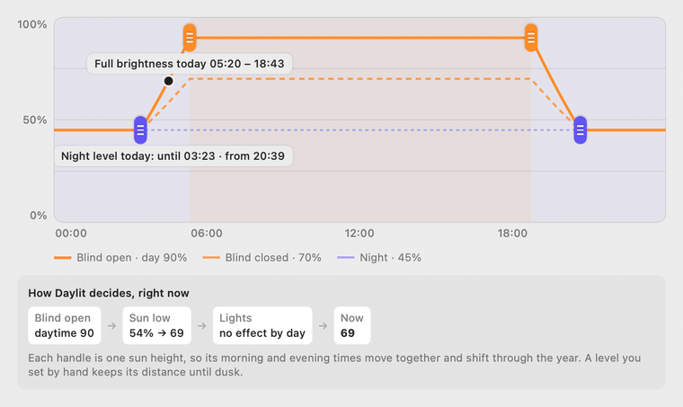
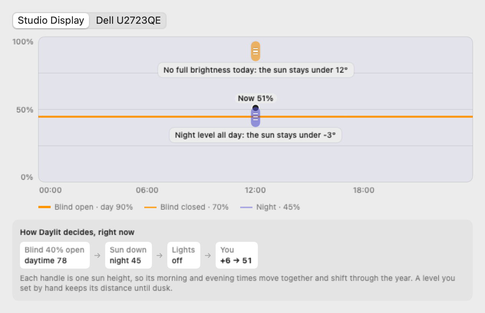

# Setting up Daylit

Daylit runs with no setup: it finds your external monitors and gives you a slider and keys for each.
This page covers everything else: automatic mode, Home Assistant, permissions and troubleshooting.

## Settings window

Gear menu → **Settings…** (on Windows also in the tray icon's menu) sets the common things without
editing a file: what brightness follows (nothing, the sun or Home Assistant), your location (typed,
or **Locate me** asks the system once), the day / blind closed / night levels and name of each
connected monitor, and Home Assistant's URL, token and room entities, with a connection test.
Moving its sliders does not change the screen; a line under each monitor shows its level right now.

It saves into the config file below and keeps everything else in it (other monitors, per-monitor Home
Assistant helpers, keys it does not show). Comments in the file are not kept.

## When the screens brighten

Settings → *Automatic* draws today for the monitor you pick: the time of day across, its brightness
up. The solid line is the blind open, the dashed one the blind closed (no blind, no dashed line), and
the dotted floor is the night level. The dot is where the monitor is right now; with *Automatic* off
or the computer idle it is the target, marked so, since nothing is being set. A linked monitor
that follows another ends on the group's level.

<p align="center">
  <picture>
    <source media="(prefers-color-scheme: dark)" srcset="chart-dark.gif">
    
  </picture>
</p>

**The handles.** The orange one sets how high the sun must be for full brightness, the purple one how
low for the night level; in between, the level blends. Drag either end sideways: each handle is one
sun height, so its morning and evening times move together (they are not a mirror around noon: they
centre on the sun's highest point). While you drag, the label shows the height it saves
("sun 12° up"). Because it is saved as a height, the times shift through the year by themselves.
*Exact values* below the chart takes the degrees directly.

**How Daylit decides, right now.** The box under the chart shows each step with today's numbers, in
the order the rules apply:

1. **The blind** picks the daytime level, between *blind closed* and *day* (40% open: 40% of the way).
2. **The sun** blends that with *night*: 100% above the orange handle, 0% below the purple one.
3. **Clouds**, with a [daylight sensor](#clouds-a-daylight-sensor), can hold the sun's share down.
4. **Room lights** only count around dusk: on, they keep the screen at least 5 above *night*. A monitor with a *Lights on* level uses that instead ([below](#lights-on-level)).
5. **Your hand**: a level you set keeps its distance from the result until dusk.

The levels themselves are per monitor (Settings → *Displays*, or Home Assistant's helpers).

### Lights on level

By default the room lights do two things for every monitor: after sunset they keep it 5 above *night*
(`tuning.brightness.lightsBoost`), and *night* is also where weak daylight (clouds, a low sun) blends to.
When your lit evening is far above the level you want on a dim morning, give that monitor a **Lights on**
level (Settings → Displays, shown when a lights entity is set; or `"nightLights"` in the config, or a
Home Assistant helper). Then:

- **Lights off:** the blend goes toward *night*, with no boost.
- **Lights on:** the blend goes toward a point that slides from *night* (sun high) to *Lights on* (sun
  down), so the lights start to count before sunset, as the sun goes down, not only below the old boost cutoff. In daylight the lamps change nothing; after sunset the monitor sits at *Lights on*; there is no
  jump at dusk.

Example, day 95, blind closed 62, night 60, lights on 80: a cloudy morning (daylight counted at half) with
the blind 40% open gives 68, 58% open 71, the blind open with daylight at 55% gives 79, and a dark evening
with the lights on gives 80. Without *Lights on* nothing changes. With Home Assistant down, a monitor with
*Lights on* keeps the last lights state Home Assistant gave (others count the lights as off, as before).
Suggestions do not learn from changes made while the lights are on and the sun is not fully up on such a
monitor, and changing *Lights on* makes that monitor's older suggestion samples stale, so its evidence
starts afresh.

### Suggested levels

When you keep correcting a monitor the same way, the panel offers new levels:

> You lower *Monitor* by about 12 with the blind partly or fully down. Set blind down 78 → 62?

- A change counts once it has held 5 minutes. Not counted: the Home Assistant `set` helper, a linked
  monitor following another, an idle or paused computer, the sun standing in while Home Assistant is
  down, the room-lights boost, a write to the monitor that failed, and levels at 0 or 100.
- A level is offered only with changes on at least 3 days in the situation where it counts most (blind
  down: daylight with the blind mostly closed; day: mostly open; night: the evening), when it moves by at
  least 5, and when the new level would have been at least 3 points closer to what you chose, on average.
- **Apply** sets the level where it lives: its `input_number` in Home Assistant (rounded to the helper's
  step), otherwise `config.json`. A `config.json` with comments is not edited; set the level in
  Settings instead. Your hand-set distance is cleared at the same time, so it is not added twice.
  **Not now** hides that monitor's suggestions for 7 days.
- The changes stay on this computer for 14 days (macOS `~/Library/Application Support/Daylit/corrections.json`,
  Windows `%LOCALAPPDATA%\Daylit\corrections.json`); nothing goes to Home Assistant or iCloud. When a
  level changes (Apply, Settings, a Home Assistant helper), it starts again from new changes.
- The log shows `suggest:` lines.
- Known gap: on a cloudy morning with the blind partly open, the blend of day and blind down lands
  near the night level whatever the light, so no level explains the change and there is no suggestion
  (issue #40).

**Short winter days and the far north.** When today's sun never reaches a handle's height, there is no
time to put it on: it rests on the day's highest (or lowest) point with a note such as *No full
brightness today: the sun stays under 12°*. Clicking it changes nothing. Dragging it away picks a
height the sun reaches today when the other handle leaves room (the full-day line always stays above
the night one); *Exact values* takes any height.

<p align="center">
  <picture>
    <source media="(prefers-color-scheme: dark)" srcset="../mac/Tests/Snapshots/curve-parked-dark.png">
    
  </picture>
</p>

## Config file

- macOS: `~/.config/daylit/config.json`, or with Settings → App → *Keep settings in iCloud Drive*
  `~/Library/Mobile Documents/com~apple~CloudDocs/Daylit/config.json`
  ([one file for all your Macs](../README.md#settings-on-more-than-one-mac))
- Windows: `%APPDATA%\Daylit\config.json`

The panel's gear menu → **Open config file** creates one if it is missing. Every key is optional;
[`config.example.json`](../config.example.json) shows them all. After editing, use **Reload config**
in the same menu. On macOS Daylit also notices the change within a few seconds.

| Key | Meaning |
|---|---|
| `source` | `off`, `sun` or `homeAssistant`. Default: `homeAssistant` when a `homeAssistant.url` is set, else `sun` when a `location` is set, else `off`. |
| `location` | `latitude` and `longitude` (city level is enough). Needed for `sun`; with Home Assistant it is the fallback. |
| `monitors` | Per-monitor overrides, matched by `match` (any case-insensitive part of the monitor's name). `label`, the levels `day`, `blindDown`, `night` (0–100, defaults 70/40/20; a value outside that range is a config problem, and a Home Assistant value above 100 counts as 100), an optional `nightLights` (0–100, [Lights on level](#lights-on-level)), an optional fixed `contrast` (0–100, [details](#contrast)) and, on macOS, `control` (`native` or `ddc`). |
| `homeAssistant` | `url`, `tokenName` (default `daylit-home-assistant`) and the entities `autoSwitch`, `sun`, `cover`, `lights` and `light` (a daylight sensor, see [Clouds](#clouds-a-daylight-sensor)), each optional. |
| `pauseOnBattery` | Starting value of *Pause on battery* in the gear menu (default `true`); the menu remembers your choice. |
| `ddcTool` | macOS only: path to `m1ddc` (Apple silicon only). Only `m1ddc` is run: the Homebrew paths (`/opt/homebrew/bin/m1ddc`, `/usr/local/bin/m1ddc`) or a file named `m1ddc` in a `PATH` folder. Any other value is ignored, with a note in `--check-config` and the log. |
| `builtIn` | macOS only: `false` hides the built-in screen's slider (shown while the lid is open; manual only, automatic mode never changes it). |

Find the `match` text for your monitors with the built-in commands:

```sh
~/Applications/Daylit.app/Contents/MacOS/Daylit --list-monitors     # macOS
~/Applications/Daylit.app/Contents/MacOS/Daylit --check-config      # exit 0 = ok
```

```powershell
& "$env:LOCALAPPDATA\Programs\Daylit\Daylit.exe" --list-monitors | Out-String   # Windows
& "$env:LOCALAPPDATA\Programs\Daylit\Daylit.exe" --check-config | Out-String
```

`--check-config` lists problems to fix, notes (for example a configured monitor that is plugged
into another computer right now) and which config entry matched which monitor.

## Home Assistant

1. Create the helpers: one `input_boolean` for automatic mode and three `input_number`s per monitor
   (day, blind closed, night). [`homeassistant/daylit_helpers.yaml`](../homeassistant/daylit_helpers.yaml)
   is a ready package. The blind and the lights are optional.
2. Create a long-lived access token: your Home Assistant profile → Security.
3. Store the token (it never goes in the config file):
   - macOS: the app asks on first start and saves it in the keychain. Gear menu → *Home Assistant
     token…* changes it. From Terminal instead:
     `security add-generic-password -s daylit-home-assistant -a homeassistant -w` (it prompts).
   - Windows: the app asks on first start and saves it in Credential Manager. Right-click the tray
     icon → *Home Assistant token…* to change it.
4. In the config, set `homeAssistant.url` and, per monitor, a `homeAssistant` block:

```json
"homeAssistant": {
  "sensor": "sensor.daylit_left_monitor",
  "day": "input_number.daylit_left_day",
  "blindDown": "input_number.daylit_left_blind_down",
  "night": "input_number.daylit_left_night",
  "set": "input_number.daylit_left_set",
  "nightLights": "input_number.daylit_left_night_lights"
}
```

- The three levels can then be tuned from any Home Assistant dashboard.
- `nightLights` is optional: a fourth `input_number` for the [Lights on level](#lights-on-level). Home Assistant's value wins when it is 0 or more.
- `sensor` is published by Daylit with what it applied (`target`, `manual`, `offset` (the hand-set distance), `daylight`,
  `light` (how clear the sky is, 0–1, with a daylight sensor), `blind`, `lights`, `source` attributes), so you can graph it.
- `set` is optional: changing that helper sets the monitor right away, even when the computer is
  idle (dim it from your phone). It then counts as a level set by hand.

With an `http://` URL the token travels unencrypted on your local network; use your `https://`
address if you have one. On macOS, plain `http://` works for local addresses only (an IP, `*.local`
or a single-word host name). `--check-config` warns when an `http://` URL points outside your local
network, where the token would cross the internet unencrypted.

Entity ids must be plain `domain.object_id` (lowercase letters, digits, `_`). Anything else is
reported as a config problem and Home Assistant is not contacted until it is fixed.

### Clouds: a daylight sensor

The sun's height says "bright day" on an overcast morning too. With `homeAssistant.light` set to a sensor
that measures daylight, Daylit knows the difference: on a cloudy day the daylight part of each target
shrinks, so the monitors stay dimmer.

- **Which sensor.** Solar panel power (W) works well; so does an outdoor lux sensor. Not an indoor one:
  the blind and the room lights already count, and they would count twice.
- **No calibration.** Daylit reads the sensor's last 10 days from Home Assistant's history when it starts,
  and again once a day. For each 2° step of the sun's height, mornings and afternoons apart, it takes what
  the sensor read on the clearest days (the 90th percentile). Panels that face east or sit in a morning
  shadow are fine: that becomes their normal. Needs a `location`, to know where the sun was at each reading.
  Changing the sensor's unit in Home Assistant (W to kW, lx to klx) starts the learning again from that
  moment, because older readings are in the other unit; until then the sun's height alone decides.
- **The effect.** Now ÷ clear sky gives how clear the sky is (0–1). That caps how much daylight counts:
  at most 35% under a fully overcast sky (`tuning.brightness.cloudyDaylight`), all of it under a clear one.
  At dawn and dusk the sun gives less than the cap anyway, so nothing changes there, and the level only
  ever rises as the sun climbs. It dims within about two minutes and brightens back over about five, so a
  passing cloud does not jump the screens.
- **When it can't tell.** No reading, a reading older than 15 minutes, or exactly 0 (an inverter that is
  off): the sun's height alone decides, as without a sensor. An export limit that caps the panels on
  sunny days reads as a clear sky, which is right; a hazy day under that limit looks a little clearer
  than it is.
- Light and dark mode and the fading of a hand-set level ignore it: a cloudy morning is still daytime.

The Settings window's *Home Assistant* pane has the field and shows what the sensor says now.

### Security notes

- **macOS keychain.** Daylit reads the token through `/usr/bin/security`. A token saved from
  Daylit's dialog trusts Daylit and that tool, so reading it never prompts; a token added from
  Terminal prompts once, naming `security`. Either way, any process running as you can read that
  one item with the same tool. Daylit doesn't read the keychain in-process because the downloadable build is
  not signed with a stable Developer ID: the keychain would ask again after every update. If that
  trade-off doesn't suit you, answer *Allow* instead (it asks again on each start).
- **The config file is trusted.** Whoever can edit `config.json` already runs code as you, so
  Daylit doesn't try to defend against a hostile config beyond rejecting malformed values (entity
  ids and the URL above).

## Keys and shortcuts

- macOS: the keyboard's brightness keys change the monitor holding the focused window (they need
  Accessibility permission; the built-in screen keeps working as usual). `⌃⌥⌘↑/↓` work without that
  permission. Add `⇧` for steps of 1.
- Windows: `Ctrl+Alt+PgUp/PgDn`, plus `Shift` for steps of 1.
- Both: `⌃⌥⌘D` (macOS) / `Ctrl+Alt+D` (Windows) switch between light and dark mode, as the gear menu item does.
- macOS's default is the key in the D position of a US keyboard, so on other layouts it may print another letter.
  On Windows, `Ctrl+Alt+D` is the same as AltGr+D on some layouts: change it if AltGr+D types a character you use.
- Both: gear menu → *Keyboard shortcuts…* to change them.

## Sync monitors

With two or more external monitors connected, a link button sits at the top of the panel, next to the
gear. It links every monitor, however many there are (click it again to unlink; while linked it is
filled with the accent colour and the monitor cards get an accent border).
With three or more monitors, each linked card also shows a small link icon: click it to take that
monitor out of the group (say a TV next to two matching monitors), and again to bring it back at
its current offset. While some are out, the header button is only outlined; clicking it links them all.
When you turn it on, Daylit remembers how far apart they are (say the Dell at 40 % and the other at
60 %: an offset of −20). From then on:

- Moving one monitor's slider, or using the keys on it, moves the others by the same amount. A
  monitor that hits 0 or 100 % stops there and lines up again when you come back.
- In automatic mode the first monitor's own target drives the group, and the others follow with
  their offsets. Their own day / blind closed / night levels are not used while sync is on.
- A monitor plugged in later joins at its current offset. A Home Assistant `set` helper still
  applies to its own monitor only. The built-in Mac screen is never part of the group.

Turn the switch off and on again to capture new offsets.

## Contrast

Optional and manual: the *Contrast* box under a monitor in Settings → Displays, or `"contrast": 60` in a
monitor's entry, sets its contrast (DDC/CI VCP code `0x12`)
once at start, and again after a display change, a wake from sleep or a config reload. Daylit never
changes it on its own and the panel has no contrast slider. The box is shown only for monitors driven
over DDC/CI; leaving it empty removes the key.

- Only monitors driven over DDC/CI get it: with HDR on (macOS's own brightness control, Windows's SDR
  content brightness) it is skipped, and HDR monitors usually ignore contrast anyway.
- Values are 0–100; outside that range they are clamped. Removing the key leaves the monitor at the
  last contrast it was given; set it in the monitor's menu or type the value you want.
- An idle computer leaves it for when you are back, like brightness, in case the monitor is showing
  another computer. A monitor that refuses it is noted in the log (`display: … did not take contrast`).

## Light and dark mode

Optional, with the sun or Home Assistant source: on by default on Windows, off by default on macOS.
Light mode when daylight comes in (sun above 4°, and with Home Assistant the blind at least 55 %
open) or when the room lights are bright and white; dark otherwise, including night with dim or
orange lights. Each condition has a gap between its on and off thresholds so it does not flip back
and forth, and a manual switch stays until the automatic decision next changes. After a start, a
config reload or turning the feature on, a reading inside a gap keeps the mode the computer already
shows; only a reading past a threshold switches it.

- Windows: if the wallpaper is one of Windows 11's stock light/dark pair, it is swapped too; a
  custom wallpaper is never touched.
- macOS: it switches the system appearance through System Events, so the first switch asks for the
  Automation permission.

Both apps: turn it on in Settings → *Appearance* (or the gear menu → *Light or dark mode from
daylight*); the gear menu also has a manual *Switch to light/dark mode*. The Appearance pane sets
when it switches, and with Home Assistant *Count the blind and the room lights* can be turned off to
follow the sun only.

## Tuning

Every number behind the rules can be changed in the config file's optional `tuning` block. The
Settings window has the ones people change: when the screens brighten (*Automatic*, [the brightness chart](#when-the-screens-brighten)) and when light and dark mode switch (*Appearance*); the `timing` keys are file only. A missing key keeps the value below; values that make no
sense (night above day, a dark edge above its light edge) are refused with the key's name.

| Key | Default | What it does |
|---|---|---|
| `brightness.sunNight` | -3 | sun elevation (°) at or below which the night level applies |
| `brightness.sunDay` | 12 | elevation from which the full daytime level applies |
| `brightness.lightsBoost` | 5 | room lights on at dusk keep the monitor this many points above night (monitors without a `nightLights` level) |
| `brightness.lightsBoostSunBelow` | 1.5 | …while the sun is below this elevation |
| `brightness.cloudyDaylight` | 35 | with a daylight sensor: the most daylight counts (%) under a fully overcast sky |
| `theme.lightSunAbove` / `darkSunBelow` | 4 / 1 | light mode above, dark below (in between, no change) |
| `theme.lightBlindAbove` / `darkBlindBelow` | 55 / 35 | blind open (%) needed for light mode / dark at or below |
| `theme.whiteLightsAbove` / `whiteLightsBelow` | 78.4 / 66.6 | lights this bright (%) and white count as daylight / stop counting (HA brightness 200 / 170 of 255) |
| `theme.whiteSaturationMax` / `warmSaturationMin` | 35 / 45 | colour saturation for "white" / "warm" (0 white … 100 deep colour) |
| `theme.room` | true | false: light/dark follows the sun only |
| `timing.pollSeconds` / `batteryPollSeconds` | 30 / 120 | how often automatic mode checks |
| `timing.idleSeconds` | 300 | no input this long: another computer may be using the monitors |
| `timing.haFallbackSeconds` | 60 | Home Assistant down this long: the sun takes over |
| `timing.manualKeepHours` | 12 | hand-set levels survive a restart this long |

An idle computer, or one paused on battery, leaves the appearance alone.

## Permissions (macOS)

| Permission | Asked when | Needed for |
|---|---|---|
| Accessibility | first start | the keyboard's brightness keys |
| Local Network | first contact with Home Assistant | reaching Home Assistant on your network |
| Automation (System Events) | first light/dark switch | light/dark mode |

All three are in System Settings → Privacy & Security. Without Local Network access Daylit cannot
reach Home Assistant; it holds the current levels for a minute, then uses the sun if a location is
set.

## Troubleshooting

- **A monitor shows "no brightness control".** Turn on DDC/CI in the monitor's own menu, and try
  another cable or port: some docks and adapters block DDC. On Apple-silicon Macs, `brew install m1ddc` if it is
  missing. m1ddc does not support Intel Macs; there only monitors that accept macOS's own
  brightness control work.
- **A monitor says "doesn't report its brightness".** Some monitors accept DDC changes but never
  answer reads. Move its slider once: if the monitor reacts, Daylit keeps it as write-only (the
  slider shows the last level sent, and automatic mode drives it). If it refuses, check DDC/CI in
  its menu.
- **Nothing changes automatically.** Check the *Automatic* switch and the status line under it;
  `--check-config` explains config problems. A computer with no input for 5 minutes stops changing
  brightness on purpose (see *Two machines* in the README), and so does a laptop on battery with
  *Pause on battery* on.
- **Logs:** `~/Library/Logs/Daylit/daylit.log` (macOS) and `%LOCALAPPDATA%\Daylit\daylit.log`
  (Windows) record automatic changes, publishes, idle/back, battery pause, theme switches and Home
  Assistant errors.
